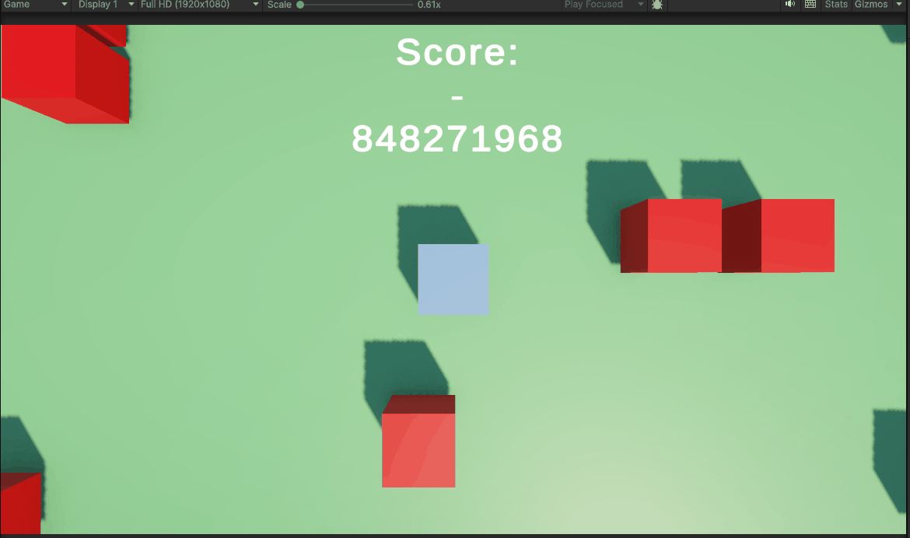

# Opdracht 02

opdracht is hier [Link naar code](https://github.com/beebopyomi/M5PROG/tree/main/Assets/)

scripts zijn hier te bevinden [scripts](https://github.com/beebopyomi/M5PROG/tree/main/Assets/Scripts)

wat is de opdracht? gwn laten zien hoe scripts met elkaar comuniceeren als ze like niet 1 script zijn.

opdracht 04 bevind zich hier [link naar opdracht](https://github.com/beebopyomi/PROG04/tree/main)

alles related aan opdracht 04 staat in de readme van 04.
